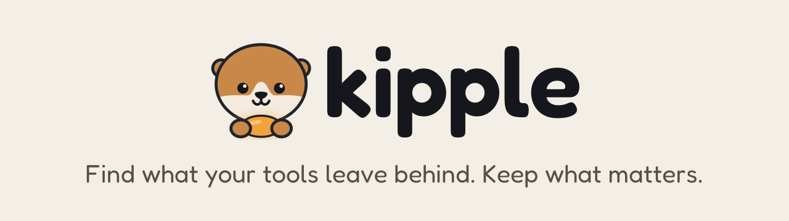

<p align="center">
  <picture>
    <source media="(prefers-color-scheme: dark)" srcset="assets/brand/banner-dark.svg">
    
  </picture>
</p>

# kipple

> Kipple: useless stuff that piles up by itself when nobody is looking. A word popularized by Philip K. Dick.

kipple finds what your tools leave behind, explains what each thing is and what you lose by removing it, and removes what is safe to remove, with a record of everything it did. It is a fast, cross-platform CLI and TUI written in Rust for Linux, macOS and Windows. It knows the footprint of coding agents (Claude Code, Codex, Pi, Cursor) and developer toolchains, and you can extend it with declarative rule packs.

**Status: M1 (core model and read-only scan) and M2 (TUI home) complete; M3 (safe mutation): the command line and the TUI both clean, and profiles keep an unattended clean to the scope you saved.** `kipple` in a terminal opens the home screen: findings stream into Safe, Review and Protected (at the level in your config, Balanced by default), grouped by project, with size bars and a sort order (`o`), each with a detail pane saying what it is, why it's here, why it's in its bucket, what you lose and how it comes back. The first run asks how careful to be and where your projects are, and suggests folders that hold projects outside the usual places. Select findings with `s`, `a` or `c`, and `enter` opens a review of exactly what would go; `y` cleans it, and `ctrl+c` stops after the item under way. `kipple scan` finds and sizes Cargo `target`, Node `node_modules`, Python `.venv` and `__pycache__`, the trash, and on Linux the pacman cache and the persistent journal, with the evidence for each, and shows retention advice for pacman, journald and Claude Code. It changes nothing. `kipple rules` lists what kipple knows, `kipple explain` says why, `kipple doctor` shows where kipple looks and what it can read, and `kipple config path|show` shows the config file, which sets the level, the project roots and the paths and rules to keep or exclude. `kipple clean` removes Safe findings once you say yes on a terminal (or with `--yes` for the rules `--only` names or a profile), by deleting them or, on Linux and macOS, moving them to the trash, and keeps a record of each run; `kipple plan -o FILE` and `kipple apply FILE` split that in two, `kipple history` lists the runs and `kipple restore` moves trashed items back. Review findings wait for the TUI's review. `kipple clean --dry-run` shows the plan and stops, and `kipple profile create NAME --from-safe` saves what `kipple clean --profile NAME --yes` may clean unattended, which `kipple profile review NAME` re-checks after the config or kipple changes. `scan`, `rules`, `doctor`, `clean`, `apply` and `history` have `--json`, and `scan`, `clean` and `apply` stream `--events jsonl`. The docs below are the plan, with a status line on each.

## Try it

These only read. `kipple --help` lists every command.

```sh
kipple                               # the home screen; a summary when piped
kipple scan                          # what was found, with the evidence for each
kipple scan --root ~/code --json     # with ~/code as the only project root, as one JSON envelope
kipple explain builtin.cargo.target  # what a rule selects, why, and what is lost
kipple doctor                        # where kipple looks and what it can read
kipple config show                   # the settings in effect
kipple history                       # every run of clean, with what happened to each item
```

These change things, and ask first on a terminal:

```sh
kipple clean                                  # show the Safe findings, ask, then remove them
kipple clean --only builtin.cargo.target --yes  # no question: delete only the Safe Cargo targets
kipple clean --method trash                   # move them to the trash instead (Linux, macOS)
kipple clean --dry-run                        # show the plan and what was left out, change nothing
kipple profile create safe --from-safe        # save what is Safe now, after you confirm it
kipple clean --profile safe --yes             # clean what the profile still authorizes, unasked
```

## Development

Install the gate tools at the versions pinned in [Decisions](docs/decisions.md) §2 (`cargo-nextest`, `cargo-deny`, `cargo-machete`, `typos-cli`), then:

```sh
cargo xtask check                    # the gate: green here is green
cargo xtask fix                      # clippy fixes, then rustfmt
cargo xtask check-arch               # crate boundaries only
cargo xtask check-docs               # the kipple commands in shell blocks parse
cargo xtask gen-docs                 # regenerate the CLI reference
cargo xtask bench-tree <dir> --entries 100000  # benchmark reference tree
cargo xtask bench-tui                # home screen keypress-to-frame p95 on the 1M tree
cargo xtask test-native              # native-backend tests: disposable hosts only (KIPPLE_TEST_DISPOSABLE_HOST=1)
git config core.hooksPath .githooks  # pre-commit: fmt, clippy, typos
```

## Docs

| Doc | What it covers |
| --- | --- |
| [Product vision](docs/01-product-vision.md) | Problem, evidence, positioning, principles, non-goals, name |
| [Market research](docs/02-market-research.md) | Mole and the landscape, gaps, plugin precedents |
| [Functional spec](docs/03-functional-spec.md) | Vocabulary, journeys, CLI, TUI, output contracts, exit codes, config |
| [Safety model](docs/04-safety-model.md) | Authority, invariants, methods, accounting, release gates |
| [Architecture](docs/05-architecture.md) | Crates, ports, engine API, events, performance, GUI reuse |
| [Integrations and rules](docs/06-adapters-and-rules.md) | Two-layer model, rule schema v1, hard cases, v0.1 catalog |
| [Rule packs](docs/07-plugins.md) | Remote packs, grants, registry, authoring |
| [Engineering standards](docs/08-engineering-standards.md) | Gate, lints, architecture checks, test philosophy |
| [Site and docs](docs/09-site-and-docs.md) | Landing page, docs site, generated references |
| [CI and release](docs/10-ci-and-release.md) | CI matrix, release pipeline, channels, signing |
| [Delivery plan](docs/11-delivery-plan.md) | Spikes, milestones M0–M7, roadmap |
| [Decisions](docs/decisions.md) | Decision log and candidate dependency versions |
| [Product context](PRODUCT.md) | Users, positioning, voice and brand commitments for design work |
| [Brand](assets/brand/BRAND.md) | Kip the otter, logo files, colours, rules |

## License

MIT. See [LICENSE](LICENSE).
